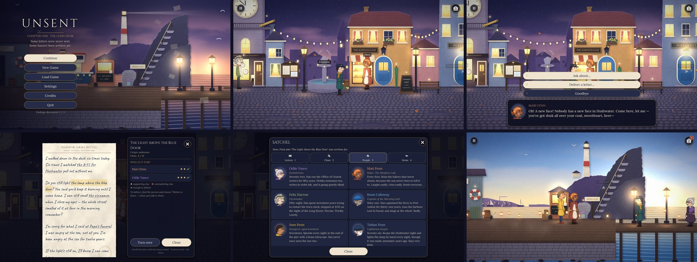

# UNSENT — PC Version (Windows)

*Some letters were never sent. Some haven't been written yet.*



This folder is the **PC edition** of UNSENT: the same game as the Android version at the root of
this repository (same story, letters, clues, characters, art, music and endings) rebuilt as a
**Windows desktop game**: widescreen, fullscreen or windowed, played with the **mouse and keyboard**.

- **Download:** [`build/UNSENT-Windows.zip`](build/UNSENT-Windows.zip) — version **1.0.1** for PC (45 MB)
- **Inside:** `UNSENT.exe` — a single, self-contained 64-bit Windows program (the game data is
  built into it), plus a read-me and the licences
- **Engine:** Godot 4.5.1 (GDScript), GL Compatibility renderer
- **No installer, no internet, no account.**

The Android project at the repository root is unchanged. This is a separate Godot project, and
Godot skips this folder when you open the Android project (it contains its own `project.godot`).

---

## Playing on Windows

1. Download [`build/UNSENT-Windows.zip`](build/UNSENT-Windows.zip) (on GitHub: open the file,
   then **Download raw file**).
2. Right-click the zip → **Extract All…**
3. Open the extracted `UNSENT-Windows` folder and double-click **`UNSENT.exe`**.

The first time, Windows SmartScreen may say *"Windows protected your PC"*, because the exe isn't
code-signed. Click **More info** → **Run anyway**.

The game starts in **fullscreen**. **F11** or **Alt+Enter** switches between fullscreen and a
window; the choice is remembered. Saves, settings and discovered endings are stored in
`%APPDATA%\UNSENT` (three save slots plus an autosave at every door and delivery, and when you quit).

**System requirements:** Windows 10 or 11 (64-bit); any graphics card with OpenGL 3.3, or
Direct3D 11 through Godot's built-in ANGLE fallback.

## Controls

| Action | Mouse | Keyboard |
| --- | --- | --- |
| Walk | Click the ground (or hold and drag) | **A / D** or **← / →** (W / S or ↑ / ↓ step nearer / further) |
| Talk to someone / examine something | Click them (hovering shows a name tag and a hand cursor) | Walk close, press **E** (the name tag shows the **E** key) |
| Continue dialogue | Click anywhere | **Space**, **Enter** or **E** |
| Choose an answer | Click it | **1 – 9**, or **↑ / ↓** then **Enter** |
| Satchel (letters, clues, people, items) | Satchel button (top right) | **Tab** or **I** (again to close); **1 – 4** or **← / →** switch tabs |
| Read a letter | Click underlined words to note clues; scroll with the **wheel** | **T** turns it over; **↑ / ↓**, **Page Up / Down** scroll |
| Close a letter or panel | **Close** button, **×**, or click outside a pop-up | **Esc** |
| Pause, save, load, settings, quit | Pause button (top left) | **Esc** |
| Fullscreen / windowed | Settings → Display | **F11** or **Alt+Enter** |

Touchscreen laptops work as well: taps behave like clicks.

## What's different from the phone version

The story and all content are the same. What changed is how the game fits a computer:

**Display**
- **Landscape 16:9** (1920×1080 layout) instead of portrait. 16:10 and 4:3 screens show a little
  more; ultra-wide screens (21:9, 32:9) show the game at 2:1 with side bars, so nothing is ever
  out of view.
- A **widescreen camera** frames each paper diorama for a monitor: the world is shown larger and
  the scenes scroll less. The lighthouse **Lamp Room** was redrawn wider (by the same art
  pipeline, with an oilskin coat, a rope coil and an oil cask on the extra wall) so it fills a
  16:9 screen.
- **Fullscreen by default**, windowed mode (1600×900, resizable, centred), **V-Sync** option, a
  landscape boot splash, and a proper Windows **icon and version information** in the exe.

**Mouse & keyboard**
- Point-and-click hover: the **cursor turns into a hand** over people, objects and exits, and
  their **name tag appears** before you click.
- **Keyboard play** throughout: walking, **E** to interact with whatever is nearest, numbered
  choices, keyboard menus, Esc / Tab / I / T shortcuts.
- Buttons are sized for a mouse (not a thumb) and all of them **light up on hover**.

**Layouts rebuilt for widescreen**
- **Title screen:** logo and menu in a column on the left, over the living harbour; adds **Quit**.
- **Dialogue:** centred box at a comfortable reading width; choices numbered 1-9.
- **Letter reader:** the letter on the left and the *"Who is it for?"* investigation board,
  title and buttons in a panel beside it.
- **Satchel:** a centred panel with letters, clues, people and items in two columns.
- **Menus and pop-ups:** centred cards; the pause menu adds **Quit to Desktop** (with a
  confirmation and an autosave). Settings add **Display** (fullscreen, V-Sync) and a
  **Controls** reference.
- Wording such as *"tap"* became *"click"*.

---

## Building from source

### 1. Toolchain (Linux x86_64)

```bash
tools/setup_toolchain.sh
```

Installs the **Godot 4.5.1** editor and its **Windows export templates**. No Windows machine,
Wine or rcedit is needed: Godot writes the exe's icon and version information itself.

### 2. Build the Windows game

```bash
tools/build_windows.sh           # -> build/UNSENT-Windows/UNSENT.exe and build/UNSENT-Windows.zip
tools/build_windows.sh --debug   # -> build/UNSENT-Windows-debug/ (debug build with a console wrapper)
```

The script imports resources, exports headlessly with the **Windows Desktop** preset (64-bit,
data embedded in the exe), adds `README.txt` and the licences, then zips the folder and prints
its SHA-256.

### 3. Open in the editor

Open `PC Version/project.godot` in Godot 4.5.x (Windows, macOS or Linux). **F5** runs the game;
*Project → Export → Windows Desktop* exports it from the editor.

### Regenerating art and audio

Same tools as the phone version (Python 3.10+, `numpy`, `pillow`, `scipy`, `ffmpeg` with libvorbis):

```bash
python3 tools/art/build_art.py lamp_room   # the widened PC lamp room
python3 tools/art/build_art.py pc          # landscape splash + Windows .ico
python3 tools/art/build_art.py             # everything
python3 tools/audio/build_audio.py         # music, ambience and SFX
```

## Tests

All of the phone version's tests run here too, plus a PC input test:

```bash
# Validate every script, dialogue jump target, clue, item, letter and condition
godot --headless --path . -s tests/check_scripts.gd

# 159 checks: four complete playthroughs, old saves, save safety, an explorer
godot --headless --path . -- --playtest=all

# PC controls with real mouse and keyboard events: title menu by keyboard,
# Space / Enter / number keys in dialogue, hover cursor and name tags,
# A/D walking, E to interact, wheel / T / Esc in letters, Tab / I satchel,
# pause and Quit to Desktop, F11 / Alt+Enter: 44 checks
xvfb-run -s "-screen 0 1920x1080x24" godot --path . --windowed --resolution 1920x1080 -- --test=pc_input_test

# Text-fit audit at 16:9, 16:10, 21:9 and 4:3 and all three text sizes: every text on screen,
# inside its frame, not cut off, not overlapping (about 35,000 checks)
xvfb-run -s "-screen 0 2600x1600x24" godot --path . --windowed --resolution 1920x1080 -- --test=ui_audit

# Touchscreen input (51 checks), the UI smoke test and the 1.0.0 save upgrade (22 checks)
xvfb-run -s "-screen 0 1920x1080x24" godot --path . --windowed --resolution 1920x1080 -- --test=touch_test
xvfb-run -s "-screen 0 1920x1080x24" godot --path . --windowed --resolution 1920x1080 -- --uismoke
godot --path . -- --test=upgrade_test --phase=setup
xvfb-run -s "-screen 0 1920x1080x24" godot --path . --windowed --resolution 1920x1080 -- --test=upgrade_test --phase=check

# Screenshot every location and screen into build/shots/
xvfb-run -s "-screen 0 1920x1080x24" godot --path . --windowed --resolution 1920x1080 -- --tour
```

## Project structure

The same layout as the phone project (see the [main README](../README.md)), with these PC
additions:

```
project.godot              1920x1080 landscape, fullscreen, %APPDATA%\UNSENT, desktop textures
export_presets.cfg         "Windows Desktop" preset (x86_64, embedded data, icon, version info)
src/autoload/settings.gd   + fullscreen / V-Sync / window size, 2:1 aspect cap
src/main.gd                + Esc, Tab / I, F11 / Alt+Enter, Quit to Desktop
src/world/location.gd      + widescreen camera, mouse hover, keyboard walking and E
src/ui/*                   widescreen layouts, hover states, keyboard shortcuts
tools/build_windows.sh     headless Windows build + zip
tools/setup_toolchain.sh   Godot + Windows export templates
tests/pc_input_test.gd     mouse & keyboard test
docs/README-Windows.txt    the read-me shipped in the zip
docs/GODOT-LICENSE.txt     Godot's licence and third-party notices (shipped in the zip)
build/UNSENT-Windows.zip   the game for Windows
```

## Credits & licenses

- Story, design, code, art direction, music and sound created for this project; all environment
  art, characters, music and effects are generated by the tools in `tools/`.
- Fonts: **Lora**, **Cinzel**, **Caveat**, **Dancing Script**, **Patrick Hand**, **Gochi Hand**,
  **Kalam**, **Handlee** — SIL Open Font License 1.1; **Special Elite** — Apache License 2.0.
  License texts are in `assets/fonts/` and in the zip's `licenses` folder.
- Built with the [Godot Engine](https://godotengine.org) (MIT License); its licence and
  third-party notices are in `docs/GODOT-LICENSE.txt` and in the zip.
