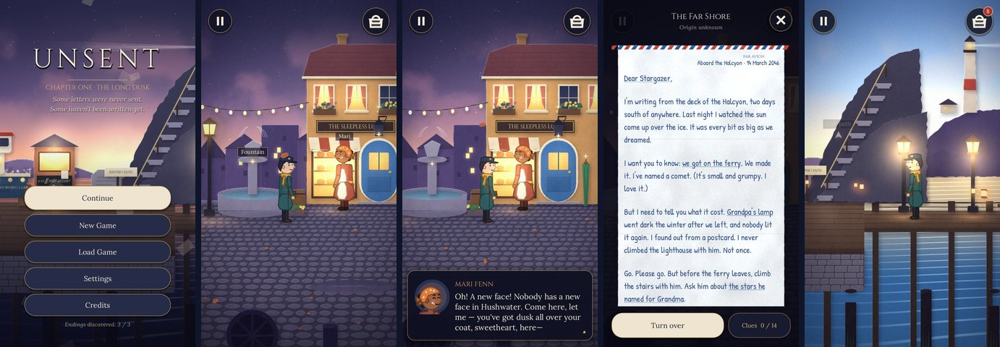

# UNSENT

*Some letters were never sent. Some haven't been written yet.*



**UNSENT** is a story-driven mystery adventure for Android phones (portrait, one-handed).
You are the new night clerk at the Office of Unsent Letters in Hushwater, a seaside town
where the sun has been setting for seventeen years. Letters nobody ever posted arrive
through a brass pipe called the Chute — with no names and no addresses. Some of them are
dated years that haven't happened yet.

Read them closely, explore the town, question its people, connect the clues, and decide
who each letter is really for. Deliver them, and the world changes. Deliver the future,
and the future changes too.

- **Download:** [`build/UNSENT.apk`](build/UNSENT.apk) (signed, Android 7.0+, ~62 MB)
- **Engine:** Godot 4.5.1 (GDScript), GL Compatibility renderer
- **No ads, no login, no internet, zero Android permissions.**

---

## Installing the APK

**On the phone directly**

1. Copy `build/UNSENT.apk` to your phone (USB, cloud drive, email…).
2. Open it from your file manager. If Android asks, allow *Install unknown apps* for
   that file manager (Settings → Apps → Special access → Install unknown apps).
3. Tap **Install**, then **Open**. The game launches in portrait.

**With adb (developer)**

```bash
adb install -r build/UNSENT.apk
```

> The APK is signed with a bundled *development* key (see [Signing](#signing)). If you
> later install a build signed with a different key, uninstall the old one first.

## How to play

| Action | Gesture |
| --- | --- |
| Walk | Tap the ground (or hold and drag) |
| Examine something | Tap it — sparkles mark things worth a look |
| Talk to someone | Tap them |
| Advance dialogue | Tap anywhere |
| Read letters, notes, people, items | Satchel button (top right) |
| Pause, save, load, settings | Pause button (top left) or Android **Back** |

**The loop:** collect a letter from the Chute → read it (tap the underlined words; turn the
envelope over) → explore and ask people about your clues → when you have **at least two
good reasons**, choose *Deliver a letter…* when talking to someone → watch the
consequences → new letters arrive.

The game never lets you deliver blind: without enough evidence the *Deliver* button stays
sealed. But evidence can point the wrong way — some letters are written to mislead.

---

## Features

### Story & content (Chapter One: *The Long Dusk*)
- **4 nights**, ending in **Lantern Night** — the storm-struck anniversary of the night the
  sun stopped.
- **Fully explorable post office** plus **four locations**: Lantern Square, Hushwater
  Harbour, Lighthouse Cliff, and the Lamp Room (locked until someone trusts you with the key).
- **Six principal characters** with their own histories, voices and secrets — Odile the
  half-blind postmistress, Tobias the lighthouse keeper, Mari the baker, June the
  stargazer, Felix the clockmaker, Bram the ferry captain — plus Theo, and Postscript the cat.
- **12 unique letters** from the **past, present and future**, each in its writer's own
  handwriting on its own stationery (hotel letterhead, airmail, a torn logbook page, a
  ferry ticket book, a bakery bag, a typewritten sheet…).
- **75 clues**, **412 dialogue scenes**, original writing throughout.
- **Three endings** (*First Light*, *The Morning Ferry*, *The Long Dusk*) plus a fates
  montage that changes with every letter's outcome.

### The letter system
- Every letter has a title, message, hidden clue phrases, envelope evidence, an origin
  (past / present / future — unknown until you find a dated clue), candidate recipients
  (including decoys), per-recipient consequences, and a delivery status
  (undelivered / delivered / kept / *faded*).
- **Investigation board** in the letter reader: who the evidence points to (●), what
  contradicts it (✗), and whether you have enough to deliver (✓).
- **Misleading letters**: a lamp above a *blue* door (two doors are blue), "Dear T."
  (more than one T), a stargazer (more than one telescope), a green umbrella (more than one
  umbrella), "my little bird" (you are, after all, named after one).
- **Return to sender, places, and yourself**: some letters can go back to their writer,
  be left at the Marguerite memorial for the drowned, or be kept.

### Time & consequence
- **Letters from the future** can be delivered to change the present — and the future
  they came from. Deliver one of June's two letters (written on the same day, from two
  lives that can't both happen) and the other **fades**.
- Persistent world changes: a lamp is relit above a blue door; the town clock restarts
  (or runs *backwards*); a character who was leaving town stays and takes over the
  lighthouse; a relationship ends forty-one years of silence; the cliff path and the lamp
  room open; Theo comes home on the ferry; the sun rises.
- **Echo letters**: changing the future makes new letters arrive *from* the changed future.
- **The finale is interactive**: if nobody else is in the lamp room at 11:40, you must
  climb the 112 steps and light the lamp yourself — oil, wick, flame.

### Presentation
- **Paper-diorama art direction**: every environment is built from layered "cut paper"
  with fibre grain, lit cut edges and soft drop shadows, rendered by the project's own art
  pipeline; parallax layers give real depth.
- **Living atmosphere**: shader sky (sun glow, twinkling stars, drifting clouds), animated
  sea with light streaks, a sweeping lighthouse beam, festoon lights, fireflies, falling
  leaves, dust motes, gulls, rain and lightning, paper lanterns.
- **Moods**: dusk, storm (darkened, rain-lashed), and a sunrise that tweens the whole world
  to dawn.
- **Vector "paper puppet" characters**, drawn at runtime (crisp at any screen density), with
  walk cycles, breathing, blinking, lip-flap, gestures (two-bone IK arms), and expressions;
  live puppet portraits in dialogue.
- Cinematic letterboxing, title cards, consequence cards, a "time ripple" screen effect,
  a delivery stamp, film grain and vignette.

### Audio (all original, generated by the project's synthesizer)
- **10 music pieces** with hand-written melodies (title theme, post office, town waltz,
  harbour, cliff, storm, Lantern Night hymn, dawn, and two emotional cues).
- **6 ambience beds** (fire & clock, town, harbour waves & gulls, cliff wind, storm, lamp room).
- **48 sound effects**: paper rustles, letter tearing and folding, the Chute's pneumatic
  whoosh and bell, wax-stamp thump, footsteps on wood / stone / grass / metal, match strike,
  lamp ignition, thunder, ferry horn, clock chimes, cat purr, text blips and more.

### Mobile UI
- Portrait, safe-area aware, one-handed: large thumb-reachable choice buttons at the bottom.
- Title screen over the living harbour; pause menu; settings (music / ambience / effects
  volume, text speed, text size, reduce motion, sparkle hints, erase data); **three manual
  save slots + autosave** on every door and delivery and when the app is backgrounded.
- Satchel journal: letters, clue notebook (grouped by letter), people (with notes that grow
  as you learn), items. Android Back button closes panels / opens pause.

---

## Building from source

### 1. Toolchain (Linux x86_64)

```bash
tools/setup_toolchain.sh
```

Installs the **Godot 4.5.1** editor, its **Android export templates**, and `apksigner` /
`adb` / `zipalign`, and lays out a minimal Android SDK directory at `/opt/android-sdk`.
UNSENT uses Godot's prebuilt-template export (no Gradle), so a full Android SDK and NDK are
**not** required — only `apksigner`. If you already have an Android SDK, set `ANDROID_HOME`.
A JDK (17+) must be on `PATH` for `keytool`.

### 2. Build the APK

```bash
tools/build_apk.sh            # -> build/UNSENT.apk   (release build, signed)
tools/build_apk.sh --debug    # -> build/UNSENT-debug.apk (debuggable)
```

The script imports resources, exports headlessly, signs, and verifies the result with
`apksigner verify`.

### 3. Open in the editor

Open `project.godot` in Godot 4.5.x. Press **F5** to play on desktop (the window is a
portrait 450×900 preview; click = tap). To export from the editor instead: *Project →
Export → Android*.

### Signing

By default the APK is signed with the **public development key** in
`android/keystore/unsent-dev.keystore` (alias `unsent`, password `unsent-dev`) — fine for
sideloading, **not** for store publication. To use your own key:

```bash
export GODOT_ANDROID_KEYSTORE_RELEASE_PATH=/path/to/your.keystore
export GODOT_ANDROID_KEYSTORE_RELEASE_USER=your_alias
export GODOT_ANDROID_KEYSTORE_RELEASE_PASSWORD=your_password
tools/build_apk.sh
```

### Regenerating art and audio

All art and audio are generated by Python tools (Python 3.10+, `numpy`, `pillow`,
`scipy`, and `ffmpeg` with libvorbis):

```bash
python3 tools/art/build_art.py                # all scenes + UI/FX textures, splash, icons
python3 tools/art/build_art.py square harbor  # selected scenes
python3 tools/audio/build_audio.py            # music, ambience and SFX (OGG Vorbis)
python3 tools/art/preview.py harbor 1200 out.png   # composite preview at a camera position
```

To replace placeholder art with hand-made art, overwrite the PNGs in
`assets/art/scenes/<scene>/` and keep (or edit) the positions in their `meta.json`.
Characters are defined in `data/characters.json` and drawn by `src/world/puppet.gd`.

## Tests

```bash
# Validate every script, dialogue jump target, clue, item, letter and condition
godot --headless --path . -s tests/check_scripts.gd

# Four complete playthroughs through the real story engine (all three endings,
# decoys, evidence rules, save/load): 84 checks
godot --headless --path . -- --playtest=all

# Drive the real UI with simulated taps (title → intro → walk → Chute → letter → talk)
xvfb-run godot --path . --resolution 720x1280 -- --uismoke

# Screenshot every location and screen into build/shots/
xvfb-run godot --path . --resolution 1080x1920 -- --tour
```

## Project structure

```
data/                  All story content (edit these to change the game)
  letters.json         Letters: text with [[phrase|clue]] markup, envelopes, outcomes
  clues.json           Clues: which letters they belong to, who they support/refute
  characters.json      Cast: bios, notes, puppet designs
  locations.json       Walk bands, objects, exits, NPC placement rules, lights
  dialogue/*.dlg       Dialogue scripts (format documented in story.dlg's header)
src/
  autoload/            Data, GameState (state + saves), Story (director/rules), Audio, Settings
  world/               Location (diorama scenes), Actor/Puppet (characters), FX, shaders
  ui/                  Dialogue box, letter reader, satchel, panels, HUD, title, endings
  main.gd/.tscn        Entry point: title, location changes, endings, lifecycle
assets/                Fonts, generated art and audio (+ Godot import settings)
tools/                 Toolchain/build scripts, art pipeline, audio synthesizer
tests/                 Content checker, playthroughs, UI smoke test, screenshot tour
build/UNSENT.apk       The compiled game
```

The dialogue format (`data/dialogue/*.dlg`):

```
=== mari.ask.c1_funeral                 # a node
mari[sad]: ...Where did you hear that?   # speaker[expression]: line   (n: = narration)
~ clue c1_theo                           # command
[if not $met_june] -> june.first         # conditional jump ($flag reads story state)
* Ask about the bakery -> mari.bakery    # choice
```

## Technical notes

- **Renderer:** GL Compatibility (OpenGL ES 3.0) for the widest device support.
  Base resolution 720×1280, `canvas_items` stretch with `expand` aspect, so tall
  (19.5:9, 20:9) phones and tablets show more of the scene instead of letterboxing.
- **Architectures:** arm64-v8a and armeabi-v7a. **Min SDK** 24 (Android 7.0), **target SDK** 35.
- **Permissions:** none. Saves live in the app's private storage (`user://`).
- **Textures** are imported with lossy WebP compression to keep the APK small.

## Credits & licenses

- Story, design, code, art direction, music and sound created for this project. All
  environment art, characters, music and effects are generated by the tools in `tools/`.
- Fonts: **Lora**, **Cinzel**, **Caveat**, **Dancing Script**, **Patrick Hand**,
  **Gochi Hand**, **Kalam**, **Handlee** — SIL Open Font License 1.1; **Special Elite** —
  Apache License 2.0. License texts are in `assets/fonts/`.
- Built with the [Godot Engine](https://godotengine.org) (MIT License).
